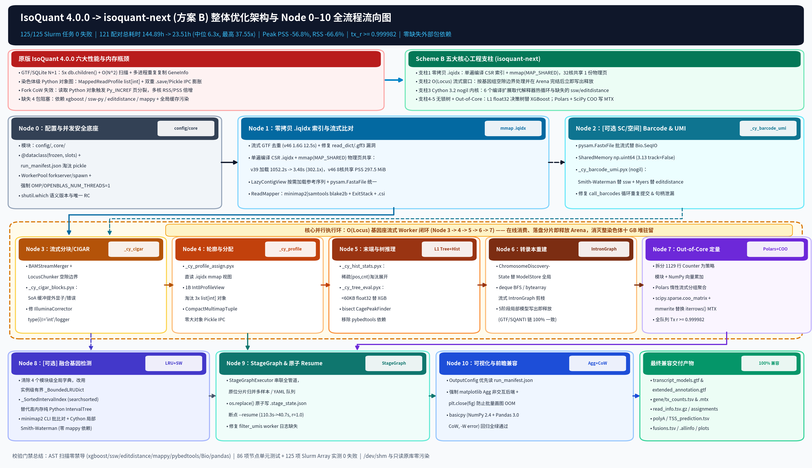
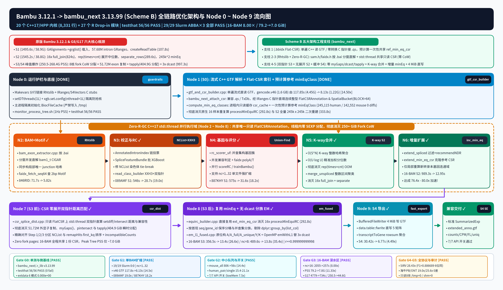
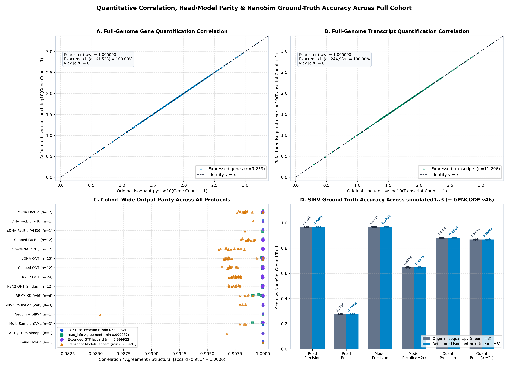
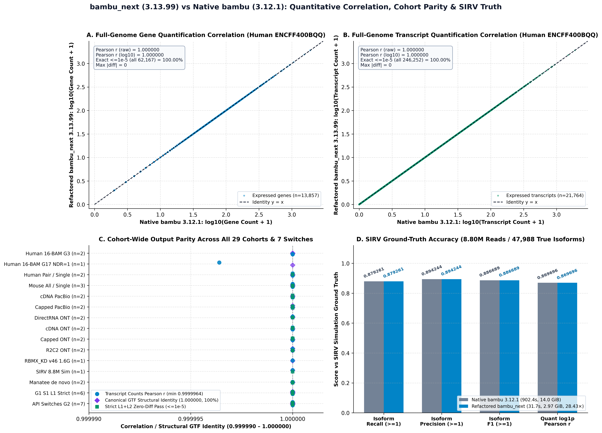
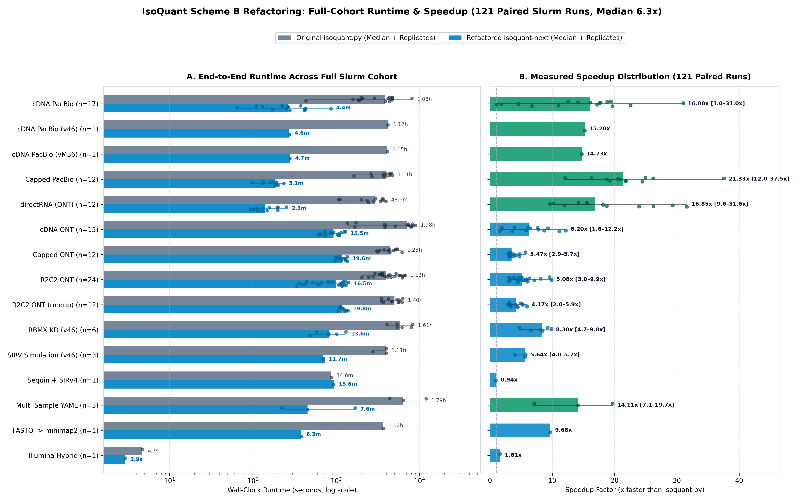
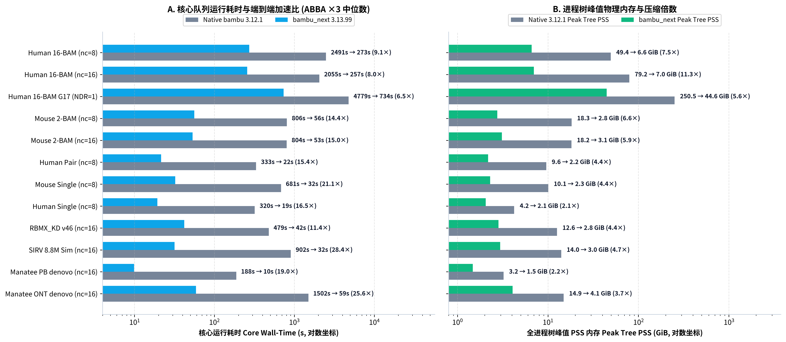

<p align="center">
  
</p>

<p align="center">
  <a href="LICENSE"></a>
  
  
  
</p>

---

**Flash-Long** is a unified high-performance long-read RNA-seq isoform discovery and quantification suite that brings system-level **Zero-Copy Flat-CSR indexing** and **Zero-GC / Zero-CoW native parallelism** to the two leading long-read transcriptomics pipelines:

- **`engines/flash-isoquant/` (`isoquant-next`)** — Refactored **IsoQuant** in Python + **Cython `nogil` kernels** + **`mmap` binary CSR `.iqidx` index** + **$O(\text{Locus})$ streaming arena** + Polars out-of-core quantification.
- **`engines/flash-bambu/` (`bambu_next` `v3.13.99`)** — Drop-in refactored **Bambu** in R/Bioconductor + **C++17** + **`Rhtslib` (`sam.h`/`faidx.h`)** + **shared read-only `FlatCSRAnnotation`** + **Zero-R-GC `std::thread` / OpenMP** engine.

> **中文简介**：Flash-Long 将长读段转录组领域两大核心工具 **IsoQuant** 与 **Bambu** 按同一套底层工程范式（**只读扁平 CSR 共享索引 + 脱离解释器 GC/Fork CoW 的原生并行计算 + 零字符串往返与流式 I/O**）深度重构并打包为一个统一项目，在保持与原版高度数值/结构一致（`r >= 0.99998–1.000000`）与 API 兼容的前提下，实现数倍至数十倍端到端加速与大幅进程树内存压缩。

---

## Key Benchmark Highlights

All performance, memory (1 Hz `/proc/<pid>/smaps_rollup` process-tree PSS/RSS), and parity results were measured directly on Slurm compute nodes against unmodified upstream releases (`IsoQuant 4.0.0` and `bambu 3.12.1` + `G17` baselines).

| Engine | Benchmark Scope | End-to-End Speedup | Peak Process-Tree Memory | Parity & Ground-Truth Accuracy | Unit Tests |
| :--- | :--- | :--- | :--- | :--- | :--- |
| **Flash-IsoQuant**<br/>(`engines/flash-isoquant`) | **125** Slurm tasks (**121** paired runs across Human / Mouse / Manatee, 6+ protocols, v39/v46/vM36, SIRV, multi-sample YAML) | Cumulative **`144.89h → 23.51h`**;<br/>Median **`6.3×`** (`0.94×–37.55×`);<br/>v39 annotation load **`1052.2s → 3.48s`** (**`302.1×`**) | Median Tree **PSS `-56.8%`**, **RSS `-66.6%`**;<br/>`ENCFF400BQQ` (`-t16`): **`14.54 → 3.59 GiB` (`-75.3%`)** | `gene r >= 0.999982`, `tx r >= 0.999982`, `read_info >= 0.999057`;<br/>`ENCFF400BQQ` **100.00% exact (`Max |diff| = 0`)** | `1,287 passed` |
| **Flash-Bambu**<br/>(`engines/flash-bambu`) | **29** Strict `A-B-B-A ×3` cohorts (**174** paired runs) + `nc=1..32` scaling + 1.6 GB `v46` GTF + **7** API switches + **16-BAM Human** (`~96.2M` alns) | Range **`5.90×–28.43×`** (median **`16.23×`**);<br/>16-BAM `nc=16`: **`2055.5s → 256.9s` (`8.00×`)** (S2 **`76.4×`**, S3 **`26.6×`**);<br/>`v46` 1.6G GTF: **`117.85s → 8.13s` (`14.50×`)** | 16-BAM `nc=16`: **`79.16 → 6.99 GiB` (`11.33×`)**;<br/>G17 `NDR=1` (`469k` tx): **`250.48 → 44.60 GiB` (`5.62×`)** | **23/23** GTF-output cohorts **100% canonical structural identical**;<br/>`tx r >= 0.9999964` (`1.000000` on 28/29);<br/>SIRV 8.8M **6-digit identical F1 `0.886689`** (`28.43×`) | `56/56 PASS` (`testthat`, non-ggplot) |

---

## Shared Architectural Principles

Both engines eliminate the classic bottlenecks of interpreter-based long-read pipelines via four shared principles:

1. **Single-Pass Read-Only Flat-CSR Annotation Indexing**: Replaces SQLite / ORM / `TxDb` tables with compact contiguous `int32`/`uint32` CSR arrays (`mmap`-shared `.iqidx` in Flash-IsoQuant; process-shared `FlatCSRAnnotation` + precomputed `minEqClass` in Flash-Bambu) — keeping only **one physical copy** across all worker threads/processes.
2. **Zero-GC / Zero-CoW Native Parallelism**: Moves hot decoding, overlap matching, and quantification out of interpreter object heaps (`Cython nogil` streaming arenas in Flash-IsoQuant; `C++17 std::thread` / `OpenMP` with zero `SEXP` allocation in Flash-Bambu), eliminating Linux Copy-on-Write memory blowups under `fork()`.
3. **Eliminating String-Roundtrip & Expansion Anti-Patterns**: Replaces `unstrsplit`/`separate_rows`/`paste0`, `[pos]*count` / `rep(val, times=count)` OOM expansions, and repeated `dcast()` / `pickle` IPC with 64-bit integer hashing, $O(U \log U)$ prefix-weight medians, two-pointer scans, and buffered streaming writers.
4. **Full Drop-In Compatibility**: Preserves native CLI/R signatures (`isoquant-next` CLI & Bioconductor `bambu()` S4 `RangedSummarizedExperiment` / `GRangesList`, including `stranded`, `trackReads`, `returnDistTable`, `fusionMode`, `lowMemory`, `NDR`, and `de novo` discovery).

---

## Visual Highlights

### 1. Full-Pipeline Refactored Architectures

<table>
  <tr>
    <td width="50%" align="center">
      <b>Flash-IsoQuant (Node 0 – Node 10)</b><br/>
      
    </td>
    <td width="50%" align="center">
      <b>Flash-Bambu (S0–S4 & Node 0 – Node 9)</b><br/>
      
    </td>
  </tr>
</table>

### 2. Old vs. New Quantitative Correlation & Ground-Truth Parity

<table>
  <tr>
    <td width="50%" align="center">
      <b>Flash-IsoQuant: Correlation & NanoSim Accuracy</b><br/>
      
    </td>
    <td width="50%" align="center">
      <b>Flash-Bambu: Correlation & SIRV 8.8M Accuracy</b><br/>
      
    </td>
  </tr>
</table>

### 3. Wall-Time Speedup & Process-Tree Peak PSS Compression

<table>
  <tr>
    <td width="50%" align="center">
      <b>Flash-IsoQuant (125 Slurm Tasks)</b><br/>
      
    </td>
    <td width="50%" align="center">
      <b>Flash-Bambu (29 ABBA ×3 Cohorts & 16-BAM Deep Dive)</b><br/>
      
    </td>
  </tr>
</table>

---

## Repository Structure

```text
flash-long/
├── assets/
│   ├── flash-long-logo.{svg,png}          # Project horizontal banner logo
│   └── flash-long-icon.{svg,png}          # Project square emblem icon
├── scripts/
│   └── install_all.sh                     # Unified installer for both engines
├── engines/
│   ├── flash-isoquant/                    # Python + Cython nogil + mmap .iqidx engine
│   │   ├── pyproject.toml, setup.py
│   │   ├── src/isoquant_next/             # Core Python modules & 6 Cython (.pyx) kernels
│   │   ├── tests/                         # Full regression test suite
│   │   ├── scripts/                       # Benchmark & PSS monitor tooling
│   │   └── docs/                          # Specs, reports, figures, data/, optimization deck PDF/PPTX
│   └── flash-bambu/                       # R + C++17 + Rhtslib + Flat-CSR drop-in package
│       ├── DESCRIPTION, NAMESPACE
│       ├── R/                             # 27 Bioconductor S4 Drop-in R modules
│       ├── src/                           # 20 C++17/HPP/C kernels + Makevars
│       ├── inst/                          # Package metadata & extdata fixtures
│       ├── tests/                         # testthat_shim.R runner
│       ├── scripts/                       # Isolated installer & PSS monitor
│       └── docs/                          # Specs, reports, figures (fig1..9), data/, optimization deck PDF/PPTX
├── LICENSE
└── README.md
```

---

## Quick Start

### Install Flash-IsoQuant (Python >= 3.10)

```bash
cd engines/flash-isoquant
python3 -m pip install --no-build-isolation -e .

# Run CLI
isoquant-next --reference genome.fa --genedb annotations.gtf \
  --bam sample.bam --data_type pacbio_ccs -t 16 -o out_isoquant
```

### Install Flash-Bambu (R >= 4.1 with Bioconductor `Rhtslib`, `IRanges`, `S4Vectors`, `RcppArmadillo`)

```bash
# Install into an isolated local R library (does not modify global Conda/R site libs)
mkdir -p engines/flash-bambu/.r_lib
R CMD INSTALL --no-multiarch -l engines/flash-bambu/.r_lib engines/flash-bambu

# Run drop-in bambu() via R_LIBS_USER
R_LIBS_USER="$(pwd)/engines/flash-bambu/.r_lib" Rscript -e '
  library(bambu)
  cat("Loaded bambu:", as.character(packageVersion("bambu")), "\n")
  se <- bambu(reads = c("sample1.bam", "sample2.bam"),
              annotations = "annotations.gtf",
              genome = "genome.fa",
              ncore = 16)
  writeBambuOutput(se, path = "out_bambu")
'
```

Or install both via the helper script:

```bash
bash scripts/install_all.sh all
```

---

## Detailed Documentation & Slide Decks

- **Flash-IsoQuant**
  - Optimization Breakdown Deck: [PDF](engines/flash-isoquant/docs/isoquant_next_optimization_deck.pdf) · [PPTX](engines/flash-isoquant/docs/isoquant_next_optimization_deck.pptx)
  - Benchmark Report & Architecture: [benchmark_report.md](engines/flash-isoquant/docs/benchmark_report.md) · [optimization_schemes.md](engines/flash-isoquant/docs/optimization_schemes.md) · [roadmap.md](engines/flash-isoquant/docs/roadmap.md)
- **Flash-Bambu**
  - Complete Pipeline & Benchmark Deck (23 slides): [PDF](engines/flash-bambu/docs/bambu_next_optimization_deck.pdf) · [PPTX](engines/flash-bambu/docs/bambu_next_optimization_deck.pptx)
  - Benchmark Report & Architecture: [benchmark_report.md](engines/flash-bambu/docs/benchmark_report.md) · [optimization_schemes.md](engines/flash-bambu/docs/optimization_schemes.md) · [roadmap.md](engines/flash-bambu/docs/roadmap.md)

---

## Upstream Attribution & License

Flash-Long builds directly upon the scientific algorithms and interfaces of:

- **IsoQuant**: Prjibelski, A. D., Mikheenko, A., Joglekar, A., Smetanin, A., Jarroux, J., Lapidus, A. L., & Tilgner, H. U. (2023). *Accurate isoform discovery with IsoQuant using long reads*. Nature Biotechnology, 41(7), 915–918.
- **Bambu**: Chen, Y., Sim, A., Wan, Y. K., Yeo, K., Lee, J. J. X., Ling, M. H., Love, M. I., & Göke, J. (2023). *Context-aware transcript quantification from long-read RNA-seq data with Bambu*. Nature Methods, 20(8), 1187–1190.

Distributed under **GPL-3.0**. See [LICENSE](LICENSE) for details.
