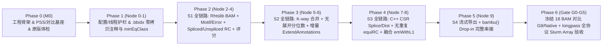

# `bambu_next` 重构与全链路性能优化路线图 (`ROADMAP`)

> **总体策略**：主推 **方案 B（C++17 + `Rhtslib` + 扁平只读 CSR/NCList + 无 R-GC 多线程引擎 + Bambu S4 Drop-in 适配器）**，按 **Phase 0 ~ Phase 6（M0_PRE ~ M10 / Node 0 ~ Node 9）** 分节点推进。每个节点须先在单元测试与原版 `bambu 3.12.1` Oracle 通过严格逐字段等价检验后，方进入下一依赖节点与端到端门禁压测。

---

## 1. 宏观阶段路线（Phases 0 ~ 6）

---

## 2. 里程碑矩阵（Milestones M0_PRE ~ M10）

| 阶段 | 里程碑 | 对应节点 | 核心工程交付成果 | 突破的核心瓶颈 | 放行条件 |
| :--- | :--- | :--- | :--- | :--- | :--- |
| **Phase 0** | **M0_PRE** | 底座 & `Node 0` | `bambu_next/` 独立 R 包骨架（`DESCRIPTION`/`NAMESPACE`/`src/Makevars` 正确链接 `Rhtslib`、`Rcpp`、`RcppArmadillo`、`IRanges`/`S4Vectors` C stub）、局部库隔离安装脚本、`monitor_process_tree.sh` 进程树 PSS 采样器、自动化等价验证器与 `T_core` 基线盘点 | `envs/bambu` 编译无冲突、进程树 PSS / wall-time 分离采集 | Hello-world `Rhtslib + Rcpp + std::thread` `.so` 编译导入通过；`bambu/tests/testthat` 官方测试套件基线跑通 |
| **Phase 1** | **M1** | **Node 1 (`S0`)** | 强类型运行时护栏（`data.table::setDTthreads(1L)`、XGBoost/BLAS 线程隔离）、流式 C++ `prepareAnnotationsFromGTF`、扁平只读 CSR 索引 `.bbidx` 与**预计算全局参考 `minEquiRC`** | 消除 `GenomicFeatures::TxDb` SQLite 开销、`245k × 245k` 全量 `minEqClass` 重复算及多核 CoW 复制 | `extdata`、`human.v39`、`mouse.vM28`、`gencode.v46` (1.6G) 输出 `GRangesList` + `minEqClass` 与原版 `identical()` |
| **Phase 2** | **M2** | **Node 2 (`S1.04–07`)** | 基于 `Rhtslib` (`sam.h` + `hts_itr_queryi` + `faidx.h`) 的并发 BAM reader（直接提取过滤后 exon blocks、observed introns、`XS` tag 与 2-bp junction motif） | 消除 `GAlignments -> grglist()` 全量 S4 物化、`57.68M` intron `GRanges` 与 `Rsamtools::scanFa` 数百万字符串 | 逐 alignment exon 坐标、`readId`、`XS` 与 unique junction motif table 与原版逐行一致；单 BAM 读入耗费与 PSS 断崖式下降 |
| **Phase 2** | **M3** | **Node 3 (`S1.09–12`)** | C++ 剪接链投票校正 (`updateStrandScoreByRead`)、XGBoost 无扩展矩阵推断（`nthread=1L`）校正 splice site、`XXH3` 多键哈希构建 Spliced & Unspliced ReadClasses | 消灭 `createReadTable` (`107.85s` `dplyr` + `unstrsplit(splitAsList)`)、`constructUnsplicedReadClasses` (`41.78s`) 与 `648 MB` `readClassSe` 膨胀 | `ENCFF400BQQ`、`ENCFF436GKZ`、`ENCFF846RID` 等全量 S1 核心检查点与原版 `identical()` |
| **Phase 2** | **M4** | **Node 4 (`S1.14`)** | 扁平 CSR `assignGeneIds`（C++ Union-Find 连通基因分簇）、`isReadClassCompatible`、polyA/T 计数、`scoreReadClasses` 与并行 `trainBambu()` | 消灭 `assignGeneIds` (`24.52s` `dplyr` + 冗余 overlap) | S1 全 18 BAM 逐 sample 输出 `RangedSummarizedExperiment` 与原版 `bambu(..., discovery=FALSE, quant=FALSE)` `identical()` |
| **Phase 3** | **M5** | **Node 5 (`S2.01–03`)** | C++ K-way 整数哈希跨样本合并 `combineSplicedTranscriptModels`、`O(U)` 精准加权分位数与直方图合并、`combineUnsplicedTranscriptModels` | 消灭 16 轮 `dplyr::full_join` (`824.29s`)、`rep(val, times=count)` 展开与 `tidyr::separate_rows()` (`289.59s`) | `human_all_d1q1` 16 样本合并候选表 `identical()` |
| **Phase 3** | **M6** | **Node 6 (`S2.04–08`)** | 增量式 `addNewSpliced/UnsplicedReadClasses`、`filterTranscriptsByAnnotation`、`recommendNDR` 与**增量 `combineWithAnnotations / getMinimumEqClassByTx`** | 消灭 `245k × 245k` extended annotations 全量二次重构 (`333.75s`) | 扩展后 `annotations` `GRangesList`、`TXNAME`/`GENEID`、`eqClassById` 与原版 `identical()` |
| **Phase 4** | **M7** | **Node 7 (`S3.01–02`)** | **C++ Flat-CSR 多线程 `calculateDistToAnnotation` / `findSpliceOverlapsByDist`** 与 `modifyIncompatibleAssignment` | **彻底消灭 S3 最大瓶颈**：`51.72M` 外显子复制、`myGaps()`、`tapply` (`2596s` 累计耗时 + `404.9 GiB` 分配 + 8 进程 `250 GiB` CoW) | `ENCFF089AMF` (`5.60M` hits) 与 `human_all` 全量 `distTable` / `compatible` / `unique` / `incompatibleCounts` 严格等价 |
| **Phase 4** | **M8** | **Node 8 (`S3.03–08`)** | C++ 全局只读一次参考 `minEquiRC` 复用 + 无 `dplyr/list-col` `genEquiRCs` + 融合无 `3× dcast` 分组分桶 + 多线程 `emWithL1` + 低拷贝 `combineCountSes` | 消灭 `16 × processMinEquiRC` (`292.8s`)、`genEquiRCs` (`886.5s`) 与 `dcast` (`997.3s`) | `counts`, `CPM`, `fullLengthCounts`, `uniqueCounts` 最大绝对误差 `< 1e-6`；相同 `equiRC` 输入与 `_bambu_emWithL1` 数学对齐 |
| **Phase 5** | **M9** | **Node 9 (`S4` & CLI)** | C++ Buffered 流式 `writeToGTF` & `writeCountsOutput`、`data.table` 参考引用 `transcriptToGeneExpression`、统一 Drop-in `bambu()` 兼容入口 + 全套单元测试回归 | 消灭 GTF R 字符串拼接与大 `SE` 二次全量展平开销 | 全部 `testthat` 套件 + `extdata` 全部组合 (`stranded`, `trackReads`, `fusionMode`, `lowMemory`, `yieldSize`, `NDR=NULL`, `returnDistTable`) 全绿 |
| **Phase 6** | **M10** | **Gates `G0–G5`** | Slurm 无上限 Array 批量基线 + 全样本配对对比、聚合脚本、出版级图表、单文件 PDF 与报告 | — | 全部 Gate 门禁通过、产出完整证据链与清理临时目录 |

---

## 3. 性能与精度验收门禁（Gates G0 ~ G5）

| 门禁 | 评测数据集 | 核心检验目标 | 门禁验收标准（Gate Pass Criteria） |
| :--- | :--- | :--- | :--- |
| **G0：基线与单测门禁** | `extdata` + `testthat` (11 suites) + 合成边界 + `ENCFF400BQQ` (92 MiB) | `bambu_next` 本地编译加载、全部单元测试与 `bambu 3.12.1` Oracle 逐项对照；确认原版可复现 baseline | 100% 单元测试通过；`ENCFF400BQQ` 输出全对象/文件严格等价 |
| **G1：S1 并发与强扩缩** | `ENCFF400BQQ`, `ENCFF436GKZ`, `ENCFF846RID`, `ENCFF089AMF` (`16.42M`), `ENCFF887KHY` (`18.28M`), `ENCFF598YQO` (`10.11M`) | 单 BAM `ncore = 1, 4, 8, 16, 32` 扩展性与全 S1 资源（无调试 RDS 干扰）；校验 `.bbidx` 热跑收益 | 无线程竞争/死锁；在 `ENCFF089AMF` 与 `ENCFF887KHY` 达成数倍端到端 S1 加速与峰值 PSS 显著压缩 |
| **G2：中等规模多协议完整流程与开关矩阵** | `ENCFF436GKZ` (`human_single`), `ENCFF598YQO` (`mouse_single`), `human_pair`, `mouse_all` + 可选参数矩阵 (`stranded`, `trackReads=F`, `fusionMode`, `NDR=NULL`, `lowMemory`, `yieldSize`, `returnDistTable`, `GTF` 原生输入) | 从 BAM 到 `extended_annotations.gtf` 与 `counts/*.txt` 完整端到端输出等价（`A-B-B-A` ×3） | 所有结构字段 L1 等价、定量 L2 `r >= 0.999999`；`mouse_all` (`1320s, 37.8G`) 等核心指标全面超越原生与 `G8` |
| **G3：核心深水区——`human_all_d1q1` 16 BAM 联跑** | Frozen Human 16 BAMs (`~96.2M` alignments，`8` workers & `16` workers 对照) | **正面超越 `native (4763s, 250.48G)`、`G8 (4610s, 254.29G)` 与 `G17 (4586s, 266.57G)`** | **无 `250 GiB` Fork CoW 爆炸**；目标实现峰值树 PSS 压降至原生 **<= 25%** 且端到端 wall-time 提速 **>= 4x**；与原版 L1/L2 等价校验全通过 |
| **G4：`longpass_benchmark250209/` 全协议全物种扩展压测** | `RBMX_KD` (`shRBMX_rep2` 7.8G + `gencode.v46` 1.6G GTF)、`SIRV_simulation` (`simulated1` 8.77M)、海牛 `Trichechus_manatus` (`de novo`) 及全协议 Slurm Array 队列 | 大注释 (`v46`) 流式解析、known/novel Recall/Precision（不低于原生基线）、非模式生物及缺失 `.bai` 隔离索引流程 | 0 OOM、0 失败；SIRV 精度与人类/小鼠/海牛产出质量与原生一致，汇总性能优于原生 |
| **G5：全量交付与现场清洁终审** | 全队列结果 + Slurm logs + Python 汇总/PDF 脚本 | `A-B-B-A` 全量 TSV/JSON 聚合、6 张高清晰科研图表 + 单文件整合 PDF、彻底清空大临时工作目录、只读目录完整无篡改校验 | 所有只读边界 SHA/时间戳无改动，系统 `/tmp` 零写入，`/dev/shm` 零泄漏 |
