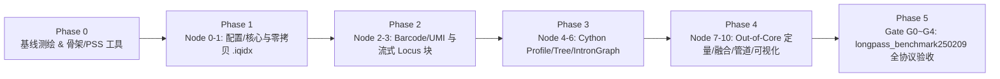

# IsoQuant 重构与性能优化路线图 (`ROADMAP`)

> **总体策略**：以**架构重写 + 低内存流式 + Cython 原生内核（方案 B）**为主线，按 **Phase 0 ~ Phase 5** 分阶段推进；每个节点完成即刻通过单元测试与原版基线等价性验证，再进入下一依赖节点。

---

## 1. 阶段总览（Phases 0 ~ 5）

---

## 2. 里程碑矩阵（Milestones M0 ~ M10）

| 阶段 | 里程碑 | 对应节点 | 核心交付成果 | 内存/时间关键工程落点 | 放行条件 |
| :--- | :--- | :--- | :--- | :--- | :--- |
| **Phase 0** | **M0_PRE** | 工程底座 | `isoquant_refactored/` 包结构、`pyproject.toml`、`setup.py` (Cython in-place 编译)、`scripts/benchmark/monitor_process_tree.sh`、基线可运行性体检矩阵 | 在 `sqanti3` 验证原版于 Tier 0 / Tier 1 / 缺失包路径下的实际阻塞点与基线 PSS/Wall-time 曲线 | Cython `.so` 示例编译通过；进程树 `PSS` 采样器跑通；原版可跑子集基线数据落盘 |
| **Phase 1** | **M0** | **Node 0** | 强类型 `dataclass` 配置、`run_manifest.json`（替代 `pickle`）、`IsoQuantExitCode`、`WorkerPoolExecutor` (`forkserver`/`spawn`)、基础公共函数 | `OMP_NUM_THREADS=1`/`OPENBLAS_NUM_THREADS=1` 默认防护、统一句柄关闭封装 | Node 0 单元测试通过；CLI 默认策略参数表与路径命名与原版 100% 对齐 |
| **Phase 1** | **M1** | **Node 1** | 修复后的二进制 Serialization、StringPool、`GTF/GFF3 -> mmap .iqidx` 单遍编译器、兼容性 `gffutils` 读取器、`read_mapper` (`blake2b` + `ExitStack` + `.csi`) | **核心突破 1**：`.iqidx` `MAP_SHARED` 只读映射替代 `GeneInfo` 与 5x SQLite N+1；`gencode.v46` 建库与 32 进程共享 PSS 近乎恒定（不随核数倍增） | `test_gene_info`/`test_serialization`/`test_string_pools` 全通过；1.6G GTF -> `.iqidx` 加载峰值 PSS 与耗时显著优于原版 `gffutils + GeneInfo` |
| **Phase 2** | **M2** | **Node 2** | `pysam.FastxFile` 流式 FASTA/Q 解析、`SharedMemoryArray2BitKmerIndexer` (`np.uint64` + 3.13 `track=False`)、Cython Smith-Waterman & Myers UMI 去重、`table_splitter` 修复 | **核心突破 2**：废弃 `Bio.SeqIO` 对象构造；`nogil` 批对齐替代缺失的 `ssw-py` & `editdistance`；修复 `call_barcodes()` 循环嵌套重复执行 bug | Barcode calling / UMI 单元测试全通过；单细胞模拟集 `.allinfo` 100% 匹配 |
| **Phase 2** | **M3** | **Node 3** | `BAMStreamMerger`、`LocusChunker`（基因组间隙流式边界）、`ReadProcessor`、修复后 `illumina_exon_corrector`、`ReadGroup` | **核心突破 3**：不再累积整条染色体读段，改为按 Locus Boundary 生成轻量定长 `SoA` 缓冲块 | `test_alignment_info`/`illumina`/`read_groups` 全通过；多 BAM 流式合并无未关闭句柄泄漏 |
| **Phase 3** | **M4** | **Node 4** | Cython `cy_profile_assign.pyx`（位图/定长区间轮廓匹配）、轻量 `ReadAssignment`、流式多映射精简归约与 `assignment_io` | **核心突破 4**：消灭百万级 Python `MappedReadProfile` `list[int]` 与 IPC 大对象 pickling；仅回传轻量 `uint32` 多映射评分表 | `test_long_read_profile`/`junction_comparator`/`long_read_assigner`/`output_formats` 全通过；逐 read 分配一致率 100% |
| **Phase 3** | **M5** | **Node 5** | 统一 `TerminalHistogram`（稀疏 `(pos, count)` Cython/NumPy 加权矩）、`cy_tree_eval.pyx`（零 XGBoost JSON 树引擎）、`np.searchsorted` 分组汇总、内置轻量 CAGE BED 索引 | **核心突破 5**：废弃 `[pos]*count` 百万列表扩展、废弃 `iterrows()`、废弃运行期 `XGBClassifier` + `DataFrame`（无需 `xgboost` 与 `pybedtools`） | `test_polya_prediction`/`terminal_peaks`/`polya_cage_finder` 全通过；`model_polya`/`model_tss` 输出概率对比离线金标误差 `< 1e-6` |
| **Phase 3** | **M6** | **Node 6** | 显式 `ChromosomeDiscoveryState`（消除 `ModelStore` 类级全局污染）、流式 IntronGraph 重建、Alt-End 精修、结构过滤与剪接位点校正 | 每个 Locus 完结即构建局部模型并流式写出 GTF/SQANTI 记录后释放 arena，大幅削减 Chr1 等超大染色体驻留内存 | `test_intron_graph`/`refine`/`graph_alt_ends`/`splice_corrector` 全通过；`transcript_models.gtf` 与原版 intron-chain 100% 一致 |
| **Phase 4** | **M7** | **Node 7** | 拆分后轻量策略计数器 (`WeightedCounter`, `JointExon`, `ExonSpliceSite`)、Polars Out-of-Core 聚合、`scipy.sparse` MTX 转换、清理后的辅助脚本 | 彻底淘汰 `df.iterrows()` 写 MTX 与全量载入分组计数表；百万读段 MTX 导出降至秒级、低 PSS | `test_feature_count_dedup`/`joint_exon`/`exon_splice_site`/`iso_quant_mode` 全通过；counts TSV/MTX 与原版精确对齐 |
| **Phase 4** | **M8** | **Node 8** | 无全局字典的 `FusionDetector`、实例级 LRU 缓存、`minimap2` CLI + Cython 局部重比对后端、`SortedIntervalIndex` | 解决 4 个全局缓存污染与 `mappy` 缺失；支持大样本低内存 SA/软剪切重比对验证 | `test_fusion_detector`/`fusion_metadata`/`fusion_validator`/`genomic_interval_index` 全通过 |
| **Phase 4** | **M9** | **Node 9** | Stage Graph 端到端管道编排器、原位分片归并器、原子化 `--resume` Checkpoint Manifest | 将 Node 0~8 串联为完整 `isoquant-next` CLI（兼容原参数），支持中断续跑、YAML 多样本集与 FASTQ/BAM 自动调度 | `simple_data/`、`toy_data/` 全部端到端模式跑通并与原版产出逐文件对齐；`ENCFF008HMY.fastq` 映射流程跑通 |
| **Phase 4** | **M10** | **Node 10** | 无 `pickle` 强依赖的 `OutputConfig`、`Agg` 可视化生命周期管理、自动化全量对照与 `basicpy` (Py3.11 + NumPy 2.4 + Pandas 3.0) 前瞻兼容回归 | 防止多样本批画图 Matplotlib OOM；保障核心数组逻辑未来向 NumPy 2 / Pandas 3 零成本迁移 | Node 10 测试与 `basicpy` 兼容性核心单测全通过 |

---

## 3. 性能与内存验收门禁（Gates G0 ~ G4，对应 Phase 5）

参照 `long_bench/docs/roadmap.md` 的 G 级校验标准，在 `/gpfs/group/data_sci_group/weiwu_group/hongyanhong/backup/longpass_benchmark250209/` 开展独立验证（**所有性能与内存测量均严格分离正确性调试转储**）：

| 门禁 | 评测集与规模 | 核心检查项 | 验收标准（Gate Pass Criteria） |
| :--- | :--- | :--- | :--- |
| **G0：基线与正确性基准** | Tier 0 (`simple_data`, `toy_data`) + Tier 1 (`ENCFF400BQQ` 92M) | 原版 IsoQuant（`sqanti3` 可运行核心模式）vs `isoquant_next` 产出逐文件 diff | 输出计数、transcript GTF、read assignment 与原版等价；建立原版 1/8/16 核 Wall-time & 进程树 Peak PSS 实测对照基线 |
| **G1：多样本轻量批量对比** | Tier 1 全集 (`ENCFF400BQQ`, `ENCFF684YOO`, `ENCFF339FMQ`) | `--threads 1, 8, 16` 多并发扩缩比 & `gencode.v39` `.iqidx` vs `gffutils.db` 加载对比 | `isoquant_next` 无线程死锁或 IPC 卡死；注释加载 + 端到端 PSS 与耗时显著下降（交替 `A-B-B-A` 至少 3 次中位数对比） |
| **G2：多协议中等代表一致性与辅助组学测试** | Tier 2 (`ENCFF436GKZ` cDNA PacBio, `ENCFF846RID`/`ENCFF207KVO` directRNA, `con_rep1` RBMX ONT + `gencode.v46`, `CAGE` + `shortreadSJ`) | 链特异性、polyA XGBoost 替代预测、`gencode.v46` (1.6G) 内存收敛、CAGE/Illumina 校正 | 所有输出文件格式合规且稳定完成；Peak PSS 较原版设计降低目标 **>= 60%**；耗时实现多倍加速 |
| **G3：千万读段全规模压力测试** | Tier 3 (`simulated1` SIRV 8.77M, `ENCFF598YQO` mouse 10.1M, `ENCFF089AMF` human 16.4M, `shRBMX_rep2` 7.8G BAM) | 高并发 (`-t 16 / 32`) 进程树 `PSS` 上限、`SIRV_simulation` 已知真值转录本 Recall/Precision 校验、染色体超长 Locus 流式释放无泄漏 | 无 OOM / 共享内存残留；Peak PSS 在多核下呈现平滑近常量特征（设计目标压缩 **70%~85%**）；SIRV 真值评估指标 >= 原版基线 |
| **G4：全套回归 & Slurm 可复现交付** | Tier 0~3 全集 + `ENCFF008HMY.fastq` + `basicpy` 前瞻环境 | Slurm 批处理基准脚本、完整量化评测报告（Wall/User/Sys Time, Peak PSS, 准确性 Diff） | 全部报告指标源自真实日志与 `monitor_process_tree.sh` 实测输出，可一键复现 |
